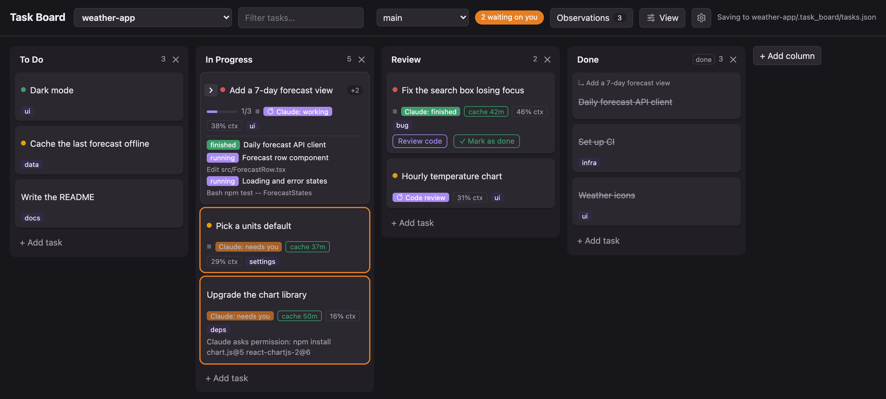
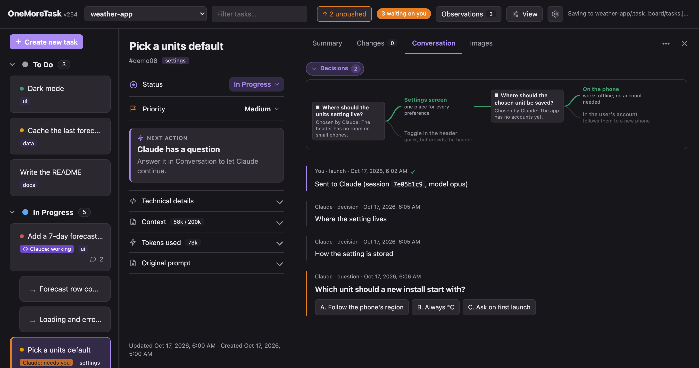
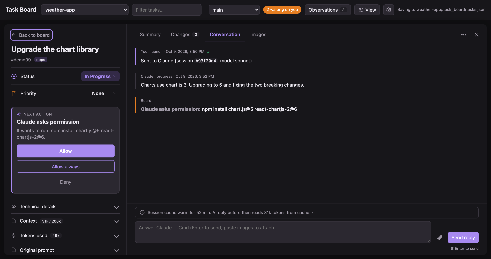
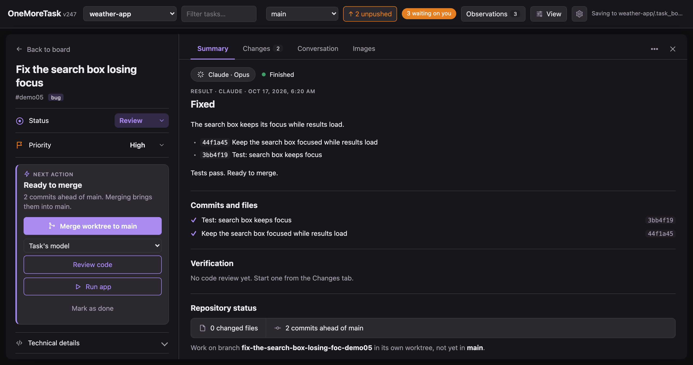
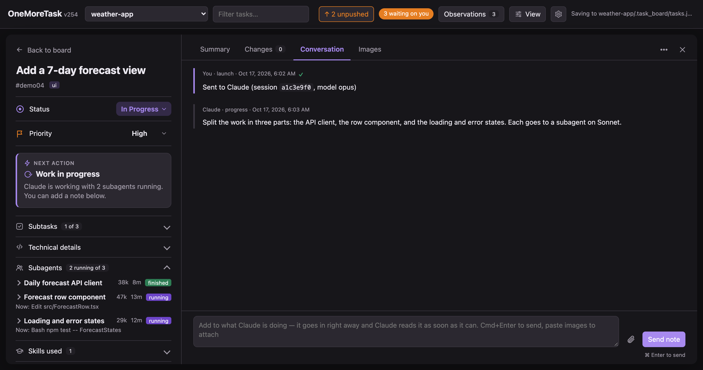

# onemoretask

A local kanban board that hands cards to Claude Code (or OpenAI's Codex). Write a task, click
**Send to Claude**, and the agent works on it in the background, posting its progress, questions,
choices and results back onto the card.



| List view: Claude asks you to pick | Claude asks permission |
|---|---|
|  |  |

| Claude is done: merge or review | Claude works with subagents |
|---|---|
|  |  |

## What it does

### Send a card to Claude

Write a task and click **Send to Claude**. A background session starts in the project folder.

By default each task gets its own git worktree, so tasks running side by side never touch each other's
files. Pick any Claude model, or an OpenAI model to run the task in Codex.

### Follow and answer on the card

The card moves from In Progress to Review on its own. A colored tag says what Claude is doing, and an
orange edge marks a card waiting for you.

Questions come with one button per answer. Permission requests get **Allow**, **Allow always** and
**Deny**. A reply resumes the same session, even while Claude is still working.

### See Claude's choices

Each choice Claude makes on its own joins one tree at the top of the card: what was asked, the options,
and the one picked. The **Decisions** button folds it away.

### Plan milestones first

The **Plan** layout holds milestones: write the tasks a goal needs, or let Claude suggest them, then send
some or all to To Do as one milestone card with subtasks. The Plan page keeps a done count.

### Split, review, finish

Tick **Divide in subtasks** and Claude hands parts of the work to subagents. The card lists each one.

When Claude is done, the card's **Next action** box has **Merge worktree**, **Run app** and **Review code**
(a second model checks the commits). **Mark as done**, and Claude writes a short recap.

**New task from this** starts a new card from a short summary of an old one.

### Better skills over time

The bundled task-observer skill notes what could make your Claude skills better. The **Observations**
button lists these notes. Tick some and click **Apply**.

### Your way

Board or list layout, light or dark, English or French, and browser notifications are all in the
**View** menu.

## Install

You need Python 3.7+, `git` and [Claude Code](https://claude.com/claude-code). Codex CLI is optional.

macOS / Linux:

```bash
curl -fsSL https://raw.githubusercontent.com/astanar01/onemoretask/main/install.sh | sh
```

Windows (PowerShell, no WSL needed):

```powershell
irm https://raw.githubusercontent.com/astanar01/onemoretask/main/install.ps1 | iex
```

The install adds the `onemoretask` command and a double-click shortcut, plus the task-observer skill and
three Claude Code tools the sessions use. It never changes your own copies or settings.
[What it installs and how to skip parts](docs/guide.md#install).

## Run

```bash
onemoretask
```

It starts the board and opens http://127.0.0.1:8765. Or double-click the **OneMoreTask** shortcut.
Options: `--port`, `--project PATH`, `--permission-mode MODE`.

To update, click the green **Update** button in the top bar when it shows.

## Privacy

Everything stays on your computer, as plain files in each project's `.task_board/` folder, kept out of
git. There is no account, no cloud service and no tracking. The server only listens on `127.0.0.1`.

Task text leaves your computer only through your own `claude` (or `codex`) command, when you send a task
or reply.
[Exactly what is sent, and when](docs/guide.md#privacy-everything-stays-on-your-computer).

## More

The [guide](docs/guide.md) has the full details: every button, worktrees, the Claude Code tools, posting
from an agent with `report.py`, the file formats, update and uninstall.
