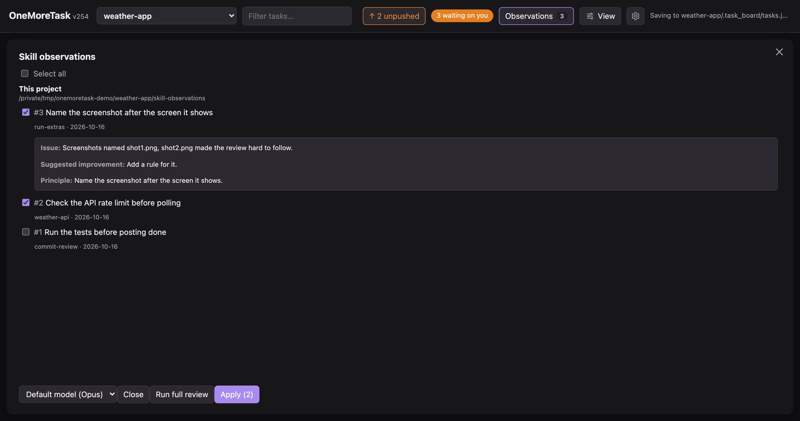

# onemoretask guide

The full details. For a quick start, see the [README](../README.md).

## Requirements

- macOS, Linux or Windows
- Python 3.7 or newer, and `git`
- [Claude Code](https://claude.com/claude-code) (the `claude` command), for Send to Claude
- Optional: OpenAI's [Codex CLI](https://github.com/openai/codex) (the `codex` command), to send a task
  or a code review to an OpenAI model

Turn on **Notifications** in the **View** menu to get a browser pop-up when Claude needs you or is done.
The **Open folder…** dialog works on macOS and Windows;
on Linux, paste the folder's path. Everything else works the same on all three.

## Install

Run this in a terminal:

```bash
curl -fsSL https://raw.githubusercontent.com/astanar01/onemoretask/main/install.sh | sh
```

It:

- downloads the app to `~/.onemoretask`
- adds the `onemoretask` command to `~/.local/bin`
- adds `~/.local/bin` to your PATH if it isn't there yet (then open a new terminal)
- copies the task-observer skill that ships with the app into `~/.claude/skills/task-observer`
  (see [Skill observations](#skill-observations)). Your own copy is never changed.
  Set `ONEMORETASK_NO_OBSERVER=1` to skip this.
- sets up the three Claude Code tools the board's sessions work with, and the hooks that make
  sessions use them (see [Claude Code tools](#claude-code-tools)). Your own copies and settings are
  never changed. Set `ONEMORETASK_NO_TOOLS=1` to skip this.
- makes a double-click shortcut that starts the board (see [Shortcut](#shortcut)).
  Set `ONEMORETASK_NO_SHORTCUT=1` to skip this.

Already cloned the repo? Run `./install.sh` inside it instead. It uses that copy.

### Windows

No WSL needed. First install:

- Python from [python.org](https://www.python.org/downloads/), or `winget install Python.Python.3.12`
- [Git for Windows](https://git-scm.com/download/win), or `winget install Git.Git`.
  Claude Code on Windows needs its Git Bash anyway.
- Claude Code with its native Windows installer (`claude.exe`), so `claude` works from PowerShell

Then run this in PowerShell:

```powershell
irm https://raw.githubusercontent.com/astanar01/onemoretask/main/install.ps1 | iex
```

It downloads the app to `%USERPROFILE%\.onemoretask`, puts `onemoretask.cmd` in
`%USERPROFILE%\.local\bin`, adds that folder to your user PATH, installs the task-observer skill
and the Claude Code tools the same way, and makes a **OneMoreTask** shortcut on the Desktop and in the Start menu. Open a new
terminal after.

Already cloned the repo? Run `powershell -ExecutionPolicy Bypass -File install.ps1` inside it.

## Run

```bash
onemoretask
```

This starts the board and opens http://127.0.0.1:8765 in your browser. If the board is
already running, it just opens the page. Press **Ctrl-C** in the terminal to stop it.
It works the same in PowerShell, cmd or a macOS/Linux terminal. Without the command,
run `python3 launch.py` (Windows: `py launch.py`) in the app folder.

### Shortcut

No terminal needed after the install: double-click the shortcut it made. It opens a terminal window
that runs the board and opens the page. Close that window to stop the board.

| System | Shortcut |
|---|---|
| macOS | `OneMoreTask.command` on the Desktop, and `OneMoreTask` in `~/Applications` (Spotlight, Launchpad) |
| Linux | `OneMoreTask` in the app menu, and `onemoretask.desktop` on the Desktop |
| Windows | `OneMoreTask` on the Desktop and in the Start menu. The window stays open if it fails (for example, no Python) |

Deleted it? Run the install command again.

### Options

| Option | What it does |
|---|---|
| `--port 9000` | Use another port (default 8765) |
| `--project PATH` | Open this folder's board |
| `--permission-mode MODE` | Permission mode for agents started with Send to Claude (default `auto`) |

Without `--project`, the board opens the projects you used before. The first time, it opens
the git repo you run it from.

## Use

### 1. Pick a project

The project menu at the top switches boards. **Open folder…** adds any folder.

Each project keeps its board in `<project>/.task_board/`. The board stays out of git: tasks are not
committed.

A project with work waiting on you shows `*` and a count in the menu, e.g. `weather-app * (2)`: questions,
plus finished cards you have not opened yet. A turning arrow marks projects where Claude is working.

### 2. Add a task

Give it a title, notes, subtasks. You can paste images into the notes. The tags you use most show under
**Tags**; click one to add it.

### 3. Send to Claude

Pick a model (or leave the default) and send. A background Claude session starts in the project folder
with the task as its prompt. Pick an OpenAI model and the task runs in Codex instead; the card works the
same.

A task with no title or no tags gets them from Haiku, which reads your notes and reuses the tags you
already have. If the task looks like it belongs to another of your projects, the board asks first: move
it there and send, or keep it here.

Tick **Divide in subtasks / use subagents** to let Claude split the work. It picks the skills each part
needs and tells that subagent to load them first. The card then lists each subagent (running, finished
or stopped), what a running one is doing now and the skills it used.

Tick **Answer only** when you just want an answer: Claude looks into it and reports back on the card, but
changes no files and makes no commits. It picks a quick, cheap model for you (Haiku, or Luna when only
Codex is set up). If you then ask that card for real work, a **Create new task** button moves the work to
a new card that starts from its summary.

### 4. Follow the card

Its tag says what Claude is doing, each in its own color: working, code review, writing the recap,
merging, needs you, finished or gone. A card waiting on you (a question, a permission request, or
finished work not merged or done yet) gets an orange edge and a **Waiting for you** tag, and the count at
the top counts it.

With **Notifications** on in the **View** menu, your browser tells you when Claude needs you or finishes,
with a chime you can turn off under **Notification sound**.

Cards move on their own: to the top of **In Progress** when Claude starts, to **Review** when it
finishes, and to **Done** when you click **Mark as done** in the open card (hidden while Claude still has
work on it). Drag a card up or down to reorder it inside its column (a subtask stays among its
siblings); it can't be dragged to another column. To move one by hand, use the Status menu in its panel.
Columns drag to reorder.

A **cache** chip counts down the session's prompt cache. Reply before it runs out ("cache cold") and the
reply reads the context from cache, at a lower price. A **ctx** chip (e.g. `38% ctx`) shows how full the
session's context is; it turns orange, then red, near the limit. If Claude stops because auto mode's
safety check keeps failing, the board starts it again after a minute.

Once the cache is cold, a **New task from this** button says whether a fresh start is a good fit (✓ good
fit, or ✕ with the reasons) and what it saves. Click it and Haiku writes a short summary of the work, and
a new card starts from it instead of re-reading the whole old session.

### 5. Open the card

The left side holds the status, the priority and a **Next action** box that says what to do now (wait,
answer, merge, review, mark done) with the button for it. Fold-out rows under it show the subtasks, the
subagents, the skills used, the context size, the tokens used (subagents included) and the exact prompt.

The right side has four tabs: **Summary** (Claude's result, its commits and whether they are merged),
**Changes** (files and commits; click one to see its diff), **Conversation** (every message, with the
reply box) and **Images**. Claude's messages show headings, lists, tables, code boxes and quotes; each
code review finding sits in its own box with how serious it is.

When Claude picks between options on its own, the choice joins one tree that runs left to right at the
top of the **Summary** and **Conversation** tabs: what was asked, each option with why, a check mark on
the one picked, and each new choice hanging off the one picked before it. The tree stays in view while
the conversation scrolls, and a box grows to show all its words when you point at it. The purple
**Decisions** button above it (with the number of choices) folds the tree away or opens it again, and
the board remembers which.

### 6. Answer questions

When Claude asks you to pick, each choice is a button: click one to answer, or type your own. When it
asks several things at once, click one answer per row, then **Send answers**.

### 7. Answer permission requests

When Claude stops to ask before running something, the card says "Claude asks permission" with the
command. Click **Allow**, **Allow always** or **Deny** on the card; the board answers the prompt in the
session for you (macOS and Linux).

### 8. Reply on the card

Answer questions or ask for changes. The reply resumes the same session.

You can also write while Claude is still working, to add information or change course. That message is a
**note**. The board types it straight into the running session (`claude attach`, like typing in Claude
Code yourself), so Claude reads it as soon as it can, even while it waits on a long command. The card
shows "Claude has it" once it is in. If a permission prompt is on screen, or on Windows, a hook the board
installs on each session (`inbox.py`) hands it over after the current step instead.

Claude answers in the language you wrote in, even if the project is in another one: a card message
plainly in another language is refused, and Claude has to write it again.

### 9. Review the code

A finished card in the Review column has a **Review code** button once the task made a commit (a Claude
message on the card names its sha). An **Answer only** card gets it only after a reply had Claude go
ahead and commit.

It starts a fresh Claude session that finds the task's commits, runs the `commit-review` skill on them
(one cheap pass; it ships in `skills/commit-review/`, and the reviewer reads it from there if it is not
installed in `~/.claude/skills/`), and posts the findings on the card. It always uses the skill's medium
budget, and runs a small test on each finding. The card shows **Code review** while it runs.

Pick the reviewer next to the button (in Next action or Changes): the task's own model, another Claude
model, or an OpenAI model, which runs the review in Codex.

Reply to have the reviewer fix the findings. When the other agent reviewed (Codex on Claude's work, or
the reverse), **Send findings to Claude** (or Codex) hands them back to the session that did the work,
with your reply box text as the word on which to fix.

### 10. Finish

**Mark as done** (or the Status menu) puts the card in Done. Once its session is idle, Claude writes a
short recap on the card (what was decided, why, how, what came out) and the board removes the session. A
later reply on the card starts a fresh session from that recap.

### List view

**View → Layout → List** shows every task in one list, grouped by column, with the open task docked on the
right (its options and its conversation side by side). A card in the list has the same **New task from
this** button and fit check as on the board. **Create new task** at the top adds one to To Do, and
the search box at the top filters the list. Drag the list's edge to make it wider or narrower; double-click
the edge to reset it. The board view is one click back in the same menu.

### Use a worktree

Every card has a **Use a worktree** box, ticked by default. A task sent with it on gets its own git
worktree, so tasks running side by side never touch each other's files; untick it and Claude edits
your project folder directly. The choice is saved on the card, so it is the same in every window.
In a folder with no git repo yet, sending asks whether to create one or to send the task without a worktree.
The board makes the worktree in
`.claude/worktrees/<task title>-<task id>` at the repo root, on a branch of the same name, and tells
Claude to do all its edits and commits there. Your own checkout stays as it was (the folder is in
`.git/info/exclude`, so `git status` stays clean). **Answer only** tasks change nothing, so they get none.

Only the board makes worktrees. Every session it starts gets `worktree.bgIsolation: none` through
`--settings`, which switches off Claude Code's own background-session isolation. Without that, a
machine whose settings leave it on would put a task in a `worktree-<name>` worktree the board never
hears of: no Run app or Merge buttons, the Changes tab reading the main folder, and an app launched
from the main folder without the task's branch. A task sent with the box off is also told in its
prompt to work in the project folder and not to make a worktree.

Every session also gets a hook (`branch_guard.py`) that stops it from switching the branch of your main
checkout (`git switch`, `git checkout <branch>`, also inside `sh -c`). Tasks without a worktree share that
checkout, and merges need it on its base branch. Switching back to the default branch is allowed, and
worktrees are left alone.

A finished card in Review then has two more buttons:

- **Run app from worktree**: Claude starts the app from the worktree (a dev server on a spare port,
  the game, a demo) and says on the card how to reach it and how to stop it.
- **Merge worktree to *branch*** (e.g. "Merge worktree to dev"): Claude commits what is left, merges the
  task's branch into the branch your checkout was on when you sent the task, then removes the worktree
  and the branch. If anything goes wrong (a conflict, your own changes in the way) it undoes the merge and asks you on the card. It never pushes.

A project with no git repo (or one with no commit yet) shows a window offering to make one: it runs
`git init` and commits everything as "Initial commit", except the board folder and `.env` files (`.env`, `.env.*`; `.env.example`,
`.env.sample` and `.env.template` are kept), which it lists in `.git/info/exclude`. It also lists the
biggest folders with their size, so you can tick the ones to leave out. On a very big folder it can take a
few minutes; the window says so and waits.

A send that fails takes its new worktree and branch away again. A card moved to done before its merge says so
under **Next action**; move it back to Review to get the buttons.

**Delete worktree** (on the card in any column, while the worktree exists and Claude is not working) removes
the worktree and its branch right away, without Claude and without merging. If that would lose work (changed
files not committed, or commits that are on no other branch) a window lists it and asks first. The board is
greyed out and locked until it finishes.

A reply sent to the card after its worktree was deleted or merged makes a fresh one (same folder and branch name,
from the main checkout's current commit), and the session is told to work there.

### Skill observations

The install command also adds the task-observer skill. The app ships its own copy in `skills/task-observer/`,
a fork of Eoghan Henn's [one-skill-to-rule-them-all](https://github.com/rebelytics/one-skill-to-rule-them-all)
(CC BY 4.0), so nothing is downloaded from that repo. Each install replaces the copy it put there before
(the one with a `FORKED_FROM` file), unless a file in it was changed since: then it keeps your edits and
says so. Delete the folder and install again to get the new version.

The skill notes what could make your Claude skills better while Claude works: a correction you made,
a step that kept failing, a workflow worth keeping. Every session the board starts is told to run it.

- The **Observations** button in the header shows how many are open. It reads
  `<project>/skill-observations/` and `~/.claude/skill-observations/` (both the older `log.md` and
  the newer `observation-log/` folder).
- Click it to see the list. Click an observation to read it.
- Tick the ones you want and click **Apply**. The board makes a new card, "Apply N skill
  observations", and sends it to Claude. The click is your approval: Claude edits the skills,
  installs them, marks each observation done, and reports on the card like any task. It asks you
  first if one needs a decision, such as a new skill.
- Observation logs and skill edits stay out of git. The board adds `skill-observations/`,
  `skill-updates/` and `.claude/skills/` to the project's `.git/info/exclude` (local only, not
  `.gitignore`) and tells each session not to commit them. Files git already tracks are not affected.



**Run full review** in the same window makes a card where Claude checks every open observation against
your skills and asks you on the card which changes to make.

### Header

- **OneMoreTask** and the app's version (e.g. `v247`). The number goes up with each new version on GitHub.
- **View**: layout (Board or List), theme (System, Light or Dark), text size, whether subtasks show,
  **Notifications** and **Notification sound**, and **Language** (English or Français: the whole page changes).
- The gear button: project settings and the **Changelog**, a plain-words list of what changed in the board.
- **Simple words** (under the gear button): Claude writes its card messages for this project in easy words, with no tech terms. It is saved in the project's `tasks.json`, and only messages written after you switch it change.
- The branch menu (e.g. `main`) shows which copy of the board app you are running and the branch it is really
  on. It turns orange on a task's worktree; pick another copy to jump to it.
- **↑ N unpushed** (orange) shows when the project has commits not pushed to its remote yet. Click it for the
  list, and **Push to remote…** there to push them to the remote branch you pick.
- **Update** (see [Update](#update)), a button that shows when a newer Claude Code is out (click it and
  confirm, and the board runs `claude update`), and a count of cards waiting on you.

### Claude Code tools

The install command also sets up three tools that the board's sessions use, plus the hooks that make
every session use them. They ship with the app in `claude/` (hooks, rules, settings) and `skills/`;
the two programs are downloaded, at a fixed version, from their GitHub releases and checked against the
release checksums. Nothing is installed if it is already there: an existing `codebase-memory-mcp` or
`muninn` on your PATH, your own hook files, and your own hook entries in `settings.json` are kept.

| Tool | What it does for a session | How it is installed |
|---|---|---|
| [codebase-memory-mcp](https://github.com/DeusData/codebase-memory-mcp) (MIT) | A code graph of the project: find a function, its callers, its source, without reading whole files. | Binary in `~/.local/bin`, MCP server `codebase-memory-mcp` in `~/.claude.json`. |
| [MuninnDB](https://github.com/scrypster/muninndb) (BSL 1.1) | Long-term memory across sessions: decisions, root causes, facts about your setup. | Binary in `~/.local/bin`, MCP server `muninn` in `~/.claude.json`; the board starts its daemon (port 8750) when it launches. Semantic recall needs [Ollama](https://ollama.com) with the `nomic-embed-text` model; without it Muninn works with word search only. |
| [context-mode](https://github.com/mksglu/context-mode) (Elastic 2.0) | Runs commands in a sandbox and indexes the output, so big outputs don't fill the context window. | Claude Code plugin, installed with `claude plugin install context-mode@context-mode`. Needs the `claude` command. |

The hooks (`claude/hooks/`, registered in `~/.claude/settings.json`) ask each session to index the project
first, block raw `grep`/`cat` on source files in favour of the code graph, and remind it to recall and store
memories. The rules (`claude/rules/`) and the `cmm-rules` / `ctx-rules` skills explain the tools to the
session. `claude/NOTICE.md` lists where the hooks come from.

Re-running the install updates the files it installed before, unless you edited them: then it keeps your
version and says so. To redo it alone: `python3 ~/.onemoretask/setup/run_setup.py`, or each part with
`python3 ~/.onemoretask/setup/install_tools.py` and `python3 ~/.onemoretask/setup/install_hooks.py`
(`--dry-run` shows what would change).

The board keeps this current by itself: each time it starts, it checks whether the setup files changed since
the last finished setup (a stamp in `~/.claude/.onemoretask-setup`) and, if so, runs the setup in the
background. So an **Update**, a `git pull`, or a copy installed before the tools existed gets them on the next
start, and the Update button reads "Setting up tools…" meanwhile. A setup where a download or the plugin
command failed is tried again at the next start. Installed with `ONEMORETASK_NO_TOOLS=1`? The stamp says
`off` and the board leaves the tools alone until you install again without it. A board started from a task's
worktree never runs it.

To see a session in the terminal: `claude agents` lists them and `claude attach <id>` opens one.

### Posting from an agent

Agents post to their card with `report.py`. The prompt Send to Claude builds already
tells them how:

```bash
python3 report.py --board <project>/.task_board <task_id> progress "what I'm doing now"
python3 report.py --board <project>/.task_board <task_id> question "what I need you to decide" \
    --option "A. Settings screen" --option "B. Header toggle"
python3 report.py --board <project>/.task_board <task_id> done "what I did, what is left"
python3 report.py --board <project>/.task_board <task_id> decision - < decision.json
```

- `--option` (2 to 6) gives the card one button per answer. For several questions at once, give each as
  `--part "<question>"` followed by its `--option`s; the answer comes back as one line per part.
- `decision` posts a choice Claude made: `{"query", "options": [{"label", "why"}], "chosen", "by", "why"}`.
  The card draws a task's decisions as one horizontal tree at the top of the Summary and Conversation tabs, each
  hanging off the option chosen before it; it redraws as decisions arrive, and a decision posted again
  with the same query replaces the earlier one.
- `--image <file>` attaches a screenshot.
- A message plainly in another language than your latest one on the card is refused; `--lang <language>`
  posts it anyway when you asked for that language.

## Where your tasks are saved

Everything is plain files on your computer. There is no database and no account.

Each project keeps its board in a `.task_board/` folder at the project's root:

```
<project>/.task_board/
├── tasks.json            the board: columns and tasks
├── images/               images pasted into a task's notes
├── .gitignore            keeps the whole folder out of git
└── agent_reports/
    ├── <task_id>.json    the messages on that card (you and Claude)
    ├── <task_id>.prompt.txt  the exact prompt Claude got when the task was sent
    └── images/           images from replies and report.py --image
```

- **Not in git.** The board is not committed: a new board folder ignores itself, and sending a task
  lists the folder in the repo's `.git/info/exclude`. A repo that already tracks its board keeps doing so
  (`git rm -r --cached .task_board` stops that).
- **Images** are named by a hash of their content, e.g. `3f9a1c0b7d2e4a61.png`.
  PNG, JPEG, GIF and WebP, up to 25 MB each.
- A project that already has `tools/task_board/tasks.json` keeps using that folder.

### `tasks.json`

```json
{
  "version": 1,
  "columns": [
    { "id": "mufe2liudtw8l", "name": "To Do", "done": false },
    { "id": "mufe2liuhd9ph", "name": "Done", "done": true }
  ],
  "tasks": [
    {
      "id": "mufeqdivus3yp",
      "title": "Add a 7-day forecast view",
      "notes": "Show highs, lows and rain chance.",
      "priority": "high",
      "tags": ["ui"],
      "column": "mufe2liudtw8l",
      "parent": null,
      "order": 0,
      "created": "2026-09-24T10:46:58.039Z",
      "updated": "2026-09-24T10:56:30.709Z",
      "agent": { "id": "04cc185b", "started": "2026-09-24T10:48:28.936Z", "model": "opus" }
    }
  ]
}
```

- `priority` is `""`, `"low"`, `"med"` or `"high"`.
- `parent` is the id of the parent task, or `null` for a top-level task. Subtasks are just
  tasks with a parent.
- `done: true` marks the column whose tasks count as finished.
- `agent` is only there once the task was sent to Claude. It holds the Claude session id.
- Optional fields: `images` (file names in `images/`), `delegate` and `subagentModel`
  (the **Divide in subtasks** options), `answerOnly` (the **Answer only** box), `worktree` (the
  **Use a worktree** box; missing counts as on).

### Card messages: `agent_reports/<task_id>.json`

A list of messages, oldest first:

```json
[
  { "at": "2026-09-24T10:48:28+00:00", "status": "launch", "message": "Sent to Claude (session 04cc185b, model opus)", "from": "you", "session": "04cc185b" },
  { "at": "2026-09-24T10:49:24+00:00", "status": "done", "message": "Added the forecast view.", "from": "claude" }
]
```

`status` is `launch`, `reply`, `note`, `review`, `progress`, `question`, `decision`, `done`, `answer` or
`recap`. `images` (file names), `session`, `options` and `parts` (a question's answer buttons) and `decision`
(the tree) are added when they apply.

### Outside the project

| File | What it holds |
|---|---|
| `~/.config/task_board/projects.json` | The projects you opened, for the project menu |
| `~/.config/task_board/default_model.json` | The name of your default Claude model, cached for 24 hours |
| `~/.claude/skills/task-observer/` | The task-observer skill, copied there by the install command |
| Desktop, `~/Applications`, app menu / Start menu | The shortcut the install command makes (see [Shortcut](#shortcut)) |
| `<project>/skill-observations/`, `~/.claude/skill-observations/` | Observations the skill logs. The board only reads them |
| `<project>/.git/info/exclude` | Gets `skill-observations/`, `skill-updates/` and `.claude/skills/` added, so skill work stays out of your commits |
| `~/.claude.json` | Only when you click **Trust folder and send**: marks that folder as trusted, like accepting Claude Code's own trust prompt |
| Your browser's local storage | View settings only: layout, list width, theme, text size, language, show subtasks, notification sound, collapsed groups, last project, last model picked, which cards you have read, unsent reply drafts |

If you open `index.html` straight from disk (a `file://` page) instead of running the
server, the board is saved in the browser's local storage only.

## Privacy: everything stays on your computer

onemoretask has no cloud service, no account, no analytics and no tracking.

- The server listens only on `127.0.0.1`, so other computers can't reach it.
- It only accepts changes from the board page itself. Other websites open in your
  browser can't use it to start agents or write files.
- The page loads nothing from the internet: no fonts, scripts or images from other sites.
- Your tasks, messages and images are only saved in the files listed above.

What does leave your computer, and why:

- **Send to Claude and replies.** They run Claude Code (`claude`), which sends the task's
  title, notes, subtasks and your replies to Anthropic, plus any image Claude opens, the same
  as when you use Claude Code in a terminal. No task data goes out until you click Send.
- **Quick Haiku calls when you send.** A task with no title or tags sends its notes to Haiku to name and
  tag it. The project check sends the task's title and notes, plus the start of each of your projects'
  README and their 15 newest card titles. The recap at Done and **New task from this** send the card's
  messages. All go through your own `claude` command.
- **The default model name.** To show the name of your default model, the board runs
  `claude -p "Reply: ok"` at most once a day (about $0.09). It sends no task data. It is
  skipped if your Claude settings or `ANTHROPIC_MODEL` already name a model.
- **Install and update.** The install command downloads the app from GitHub. The board's
  **Update** button runs `git fetch` on the app folder when the page opens and every 30 minutes,
  to compare your copy with GitHub, and asks npm for the newest Claude Code version. It sends no task data.

## Update

The **Update** button in the top bar turns green when GitHub has a newer version. Click it:
the board pulls the new version (`git pull --ff-only`), restarts its server and reloads the page. When the
new version brings new Claude Code tools, hooks or skills, the restarted board sets them up in the background.
It stays grey when your copy is current, and says why when it can't update by itself (local
changes, or commits that are not on GitHub).

Or by hand: run the install command again. It pulls the latest version into `~/.onemoretask`.
Installed from your own clone? Run `git pull` in it instead.
Then restart the board (Ctrl-C in its terminal, then `onemoretask`): a running board keeps its old
server code until restarted.

## Uninstall

```bash
rm ~/.local/bin/onemoretask
rm -rf ~/.onemoretask
rm -rf ~/.config/task_board   # remembered projects and settings
rm -rf ~/.claude/skills/task-observer   # only if you don't want the skill any more
```

The Claude Code tools stay (other sessions may use them). To remove them too: `codebase-memory-mcp uninstall`,
`muninn stop` then `rm ~/.local/bin/muninn` and `rm -rf ~/.muninn`, `claude plugin uninstall context-mode@context-mode`,
and delete the hook files listed in `~/.claude/.onemoretask-install-sums` plus their entries in `~/.claude/settings.json`.

On Windows (PowerShell):

```powershell
Remove-Item ~\.local\bin\onemoretask.cmd
Remove-Item -Recurse -Force ~\.onemoretask
Remove-Item -Recurse -Force ~\.config\task_board
```

Your boards stay in each project's `.task_board/` folder.

## More

Full behaviour: the header docstring of `server.py`. Board storage: `reports.py`.
